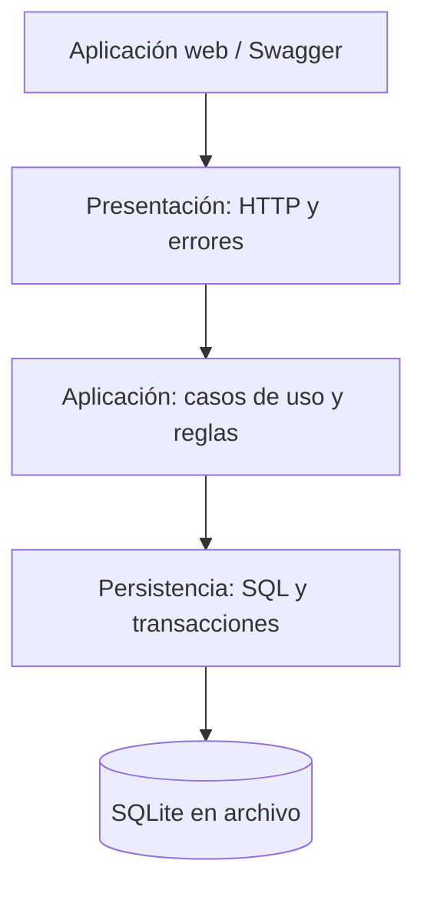
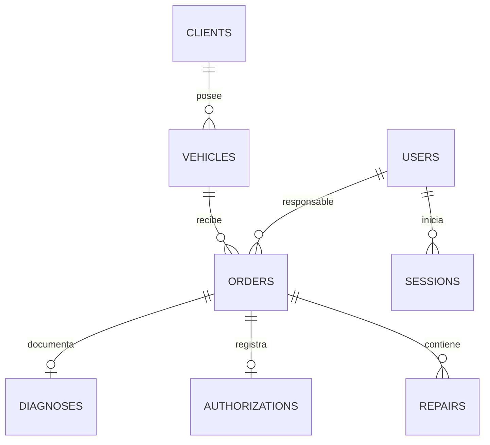
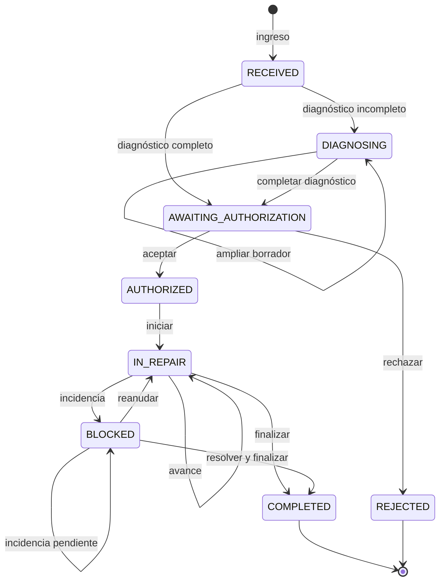

# Arquitectura de MecaGest

Los servicios comprueban roles, validan entradas con Zod y coordinan repositorios. Los repositorios usan SQL parametrizado; no deciden permisos ni transiciones. `bootstrap.ts` compone las capas y `domain` solo contiene tipos. `tests/architecture.test.ts` verifica las dependencias prohibidas.

La interfaz de `src/presentation/web/` se sirve desde el mismo proceso Express y usa la API mediante `fetch`. Ofrece formularios y adapta las acciones visibles al rol; las reglas y permisos definitivos permanecen en aplicación. No accede directamente a SQLite. El token se guarda en `sessionStorage` de la pestaña; las contraseñas no se guardan en el navegador. El texto ingresado se escapa antes de insertarlo en HTML. El cierre de sesión revoca el token en el servidor.

## Modelo y estados

Cada diagnóstico, autorización y actividad conserva responsable y fecha UTC ISO 8601. Una placa normalizada identifica un vehículo. Un índice parcial impide dos órdenes abiertas del mismo vehículo. No hay borrado por HTTP en esta entrega.

Diagnóstico completo y autorización son inmutables. Un rechazo o cierre termina la orden y permite un nuevo ingreso. Una corrección futura necesitaría un flujo explícito de revisión. Se exige actividad final no vacía, pero su exactitud técnica requiere revisión humana. Los trabajos adicionales no se presumen autorizados: esta versión registra incidencias, pero no gestiona presupuestos ni reautorización.

## Permisos propuestos

| Operación | ADMIN (encargado) | RECEPTIONIST | MECHANIC |
|---|---|---|---|
| Registrar clientes, vehículos y órdenes | Sí | Sí | No |
| Listar clientes y mecánicos | Sí | Sí | No |
| Listar vehículos/órdenes y consultar una orden | Sí | Sí | Sí |
| Diagnosticar y reparar | Sí | No | Solo asignado |
| Registrar decisión del cliente | Sí | No | No |
| Consultar historial por placa | Sí | No | Sí |

Recepción puede consultar una orden operativa; el historial completo por placa queda para mecánico/administrador. El cliente no inicia sesión: el encargado registra la constancia de su decisión. Este reparto debe validarse con un taller.

## Integridad y autenticación

Las mutaciones de órdenes ejecutan lectura de estado, reglas y escrituras dentro de `BEGIN IMMEDIATE` / `COMMIT`, con `ROLLBACK` ante error. El callback es síncrono para que la operación no escape de la transacción. QA-03 se comprueba con triggers temporales que fallan antes/después de insertar actividad y después de actualizar el estado. El GET posterior debe ser idéntico al anterior. No equivale a probar cortes eléctricos.

Las contraseñas usan scrypt con sal aleatoria. Se generan tokens de 32 bytes aleatorios y se almacena su SHA-256; caducan en 8 horas y se revocan al cerrar sesión. El login admite 10 solicitudes por IP/minuto, con contador en memoria. Los errores internos no muestran trazas ni SQL. El servidor escucha en localhost; un despliegue externo necesitaría HTTPS y gestión operativa adicional.

## SQLite y límites

La consigna cita PostgreSQL como referencia y permite equivalentes. SQLite permite una entrega reproducible con Node.js 24 y persistencia relacional real, claves foráneas y transacciones. El esquema tiene versión y las pruebas cierran y reabren un archivo para verificar conservación de registros.

Las escrituras se serializan y las llamadas son síncronas. No se extrapolan estos resultados a alta carga ni a varios talleres/procesos. Migrar a PostgreSQL afectaría la persistencia y sus pruebas; los controladores no deberían cambiar.

Referencias técnicas: [SQLite en Node.js 24](https://nodejs.org/download/release/latest-v24.x/docs/api/sqlite.html), [errores de Express](https://expressjs.com/en/guide/error-handling/).
